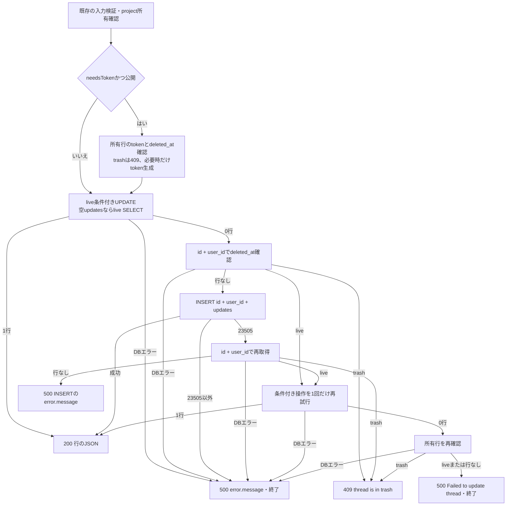

# Phase 2b 実装報告

## 1. 変更ファイル一覧

以下35ファイル。新しいルートは作成していない。既存 `DELETE /api/threads/[id]` の関数本体、DB・migration・RLS・Cron は変更していない。作業前から未追跡だった Phase 2a 報告書も変更していない。

- `app/api/arena/route.ts`
- `app/api/chat/route.ts`
- `app/api/extract-settings/route.ts`
- `app/api/image-gen/route.ts`
- `app/api/lore/like/route.ts`
- `app/api/mcp/threads/[id]/messages/route.ts`
- `app/api/messages/[id]/route.ts`
- `app/api/share/[token]/fork/route.ts`
- `app/api/threads/[id]/branch-to/route.ts`
- `app/api/threads/[id]/copy/route.ts`
- `app/api/threads/[id]/messages/[messageId]/route.ts`
- `app/api/threads/[id]/messages/restore-branch/route.ts`
- `app/api/threads/[id]/messages/route.ts`
- `app/api/threads/[id]/notes/route.ts`
- `app/api/threads/[id]/route.ts`（PATCH のみ。DELETE 本体は変更なし）
- `app/api/threads/[id]/tags/route.ts`
- `lib/lore/batchTrain.ts`
- `lib/messages/delete.ts`
- `lib/threadResourceCrud.ts`
- `lib/threads/trash-errors.ts`（新規）
- `lib/threads/purge.ts`（新規、ルート未接続）
- `scripts/arena-usage.test.cjs`（既存 mock 更新）
- `scripts/lore.test.cjs`（所有親確認の mock・期待値を追加）
- `scripts/message-delete.test.cjs`（親確認の mock・履歴期待値更新）
- `scripts/project-id-write-contract-routes.test.cjs`（条件付き UPDATE の mock・期待値更新）
- `scripts/restore-branch-route.test.cjs`（事前 SELECT の mock 更新）
- `scripts/thread-trash-reads.test.cjs`（2b の確認方法に合わせて更新、GET 範囲を限定）
- `scripts/threadResourceCrud.test.cjs`（追加 SELECT の mock・期待値更新）
- `scripts/thread-trash-writes.test.cjs`（新規、静的テスト）
- `scripts/thread-trash-test-helpers.cjs`（新規、PostgREST mock 共通処理）
- `scripts/thread-trash-patch.test.cjs`（新規、PATCH 動作テスト）
- `scripts/thread-trash-purge.test.cjs`（新規、purge mock・純関数テスト）
- `scripts/thread-trash-resources.test.cjs`（新規、子リソース・メッセージ削除・Lore 動作テスト）
- `scripts/thread-trash-branch-rpc.test.cjs`（新規、RPC 再確認・arena 動作テスト）
- `docs/thread-trash-phase2b-report.md`（新規、本報告）

## 2. 経路表

所有者を確認できたゴミ箱に限り409。以下の「前」は事前確認時点を指す。確認後の競合は第6項を参照。認証・入力検証エラーの優先順位は従来の検証を基本的に保持する。副作用前の親確認で DB エラーが起きた場合は処理を止め、既存形式の500を返す。

共通 `getOwnedThreadTrashState` は `id, deleted_at` を SELECT し、必ず `id` と認証ユーザーの `user_id` で絞る。ゴミ箱を隠す `.is("deleted_at", null)` は付けない。共通409レスポンスはボディ・status の tuple なので NextResponse と finalizeJson の双方で利用できる。

| 経路 | HTTPメソッド | 判定方法 | ゴミ箱時の応答 | 副作用より前か | 結果 |
|---|---|---|---|---|---|
| `/api/threads/[id]` | PATCH | live 条件付き UPDATE → 0行なら所有行の deleted_at を確認。空更新は live SELECT | 409 `{"error":"thread is in trash"}` | 前。条件付き UPDATE 自体は0行 | 対応した |
| `/api/threads/[id]/messages/[messageId]` | PATCH | URL の親を所有者付きで確認 | 同上409 | messages UPDATE 前 | 対応した |
| 同上 | DELETE | deleteOwnedMessage が対象 message の thread_id から親を確認 | 同上409 | Lore archive・DELETE・Storage 前 | 対応した |
| `/api/threads/[id]/messages` 範囲削除 | DELETE | 既存所有者 SELECT で deleted_at も読む | 同上409 | 対象一覧取得・Lore archive・DELETE・Storage 前 | 対応した |
| `/api/messages/[id]` content / is_hidden / delete_image | PATCH | 本人の message の thread_id → 所有親確認 | 同上409 | Storage remove・metadata/content UPDATE 前 | 対応した |
| `/api/messages/[id]` | DELETE | deleteOwnedMessage で本人 message の thread_id → 所有親確認 | 同上409 | Lore archive・DELETE・Storage 前 | 対応した |
| deleteOwnedMessage の thread-scoped 未存在 message | DELETE 内部 | 既存の `ok:true` を維持、親判定前に終了 | 従来の200 success | 副作用なし | 対応不要（削除対象なしの既存契約） |
| `/api/threads/[id]/tags` | POST | URL の所有親確認 → 重複確認 → INSERT。トリガー競合も変換 | 同上409 | 重複確認・INSERT 前 | 対応した |
| 同上 | DELETE | URL の所有親確認。DELETE 自身も URL の thread_id で絞る | 同上409 | DELETE 前 | 対応した |
| notes / message-notes / drafts 共通 helper | POST | URL の所有親確認。INSERT トリガー競合も変換 | 同上409 | INSERT 前 | 対応した |
| 同 helper | DELETE | 本文 id + user_id で対象行の thread_id を SELECT → その所有親を確認 | 同上409 | DELETE 前 | 対応した。URL 偽装で回避不可。新たな URL 一致制約は追加していない |
| `/api/threads/[id]/notes` 独自処理 | PATCH | 本文 id + user_id で thread_notes.thread_id を SELECT → その所有親を確認 | 同上409 | content / updated_at UPDATE 前 | 対応した。未存在は従来の single() 失敗500 |
| `/api/mcp/threads/[id]/messages` | POST | service role の既存所有者 SELECT に deleted_at 追加 | 同上409 | INSERT・updated_at UPDATE 前 | 対応した。未存在404を維持、時刻更新にも live 条件 |
| `/api/chat` 通常・再生成 | POST | 非 temporary の既存 lookup と作成後 recheck で deleted_at を読む | chatResponse の JSON409 | AI・user 保存・その他後続処理前 | 対応した。行がないときだけ既存のスレッド確保へ |
| 同 branch edit | POST | P0001 `thread not found` の場合のみ所有親を再取得 | trash 409、それ以外は既存400 | RPC はDB側で拒否。再確認後は処理停止 | 対応した。他の P0001 は400維持 |
| `/api/threads/[id]/messages/restore-branch` | **PATCH** | RPC 前に所有親確認。P0001 `thread not found` 後も再取得 | trash 409、それ以外は既存400 | RPC 前。競合時はRPCが拒否 | 対応した |
| `/api/image-gen` 保存先 | POST | 先頭所有者確認で deleted_at を読む | 事前確認409。INSERT競合時は既存の `DB保存失敗: ...` 本文を維持しstatusだけ409 | 事前確認は外部 AI・Storage upload 前 | 対応した。アップロード後の後始末は新設していない |
| `/api/extract-settings` | POST | 既存保存先確認で deleted_at を読む | 共通409 | LLM・novel_settings upsert 前 | 対応した |
| `/api/arena` ensureArenaThread 初回 lookup | POST | `id, deleted_at` を所有者付き SELECT、trashなら INSERT 分岐前に拒否 | `{ok:false,response:409}` をルートで返す | 新規作成・AI・messages INSERT 前 | 対応した。live フィルタは付けていない |
| 同 ensureArenaThread 23505 後 recheck | POST | 同様の SELECT、trashなら成功扱いにしない | 同上409 | 後続の AI・子 INSERT 前 | 対応した。既に試行した同時作成 INSERT の失敗は維持 |
| `/api/arena` 非初回ターン | POST | isFirst の else で所有親確認。未存在は従来どおり自動作成しない | 共通409 | 介入 INSERT・callAI 前 | 対応した |
| `/api/arena` timeTravel | POST | 所有親確認。未存在は既存の0行 DELETE に進む | 共通409 | messages DELETE 前 | 対応した |
| `/api/arena` saveHumanMessage | POST | ensureArenaThread と INSERT エラー分類 | 事前確認・トリガー競合とも409 | 事前確認は INSERT 前 | 対応した。必要時の従来補償は維持 |
| `/api/lore/batch-train` | POST | fetchTargetMessages の live 入力選定に加え、保存前に所有親を再取得 | バッチは成功扱いで当該 message を skip | createEmbedding・Lore INSERT・is_learned 更新前 | 対応した。skip は `securityGuardRejected` の skippedCount:1 で記録 |
| `/api/lore/like` | POST | message未存在→親未存在→双方の所有者確認→trash→role の順 | 本人trashのみ共通409。他人は既存404/403 | 重複確認・embedding・INSERT 前 | 対応した |
| arena の新規 thread 補償 DELETE | POST 内部 | 作成した threadId + user_id + `deleted_at is null` | trashなら0行、元の保存失敗応答を維持 | DELETE 自体が条件付き | 対応した。0行はログエラーにしない |
| copy の新規 thread 補償 DELETE | POST 内部 | newThread.id + `deleted_at is null` | 同上 | 同上 | 対応した。既存 user_id 条件なしを保持 |
| branch-to の新規 thread 補償 DELETE | POST 内部 | newThread.id + `deleted_at is null` | 同上 | 同上 | 対応した。既存 user_id 条件なしを保持 |
| share fork の新規 thread 補償 DELETE | POST 内部 | newThread.id + `deleted_at is null` | 同上 | 同上 | 対応した。既存 user_id 条件なしを保持 |
| arena の介入 message 補償 DELETE | POST 内部 | 追加調査で発見。既知の threadId の所有親を確認しtrashなら補償削除をskip | 元の200 saved:falseを維持 | 子 DELETE 前 | 小さな追加対応。確認後のDELETE競合は残る |
| `purgeThread` user | ルート未接続 | 認証 client + authenticatedUserId。DELETE を owner + trash 条件で実行し返却行を確認 | outcome deleted / not_found / error | 全ページのパス収集がDB削除前、Storageは削除成立後だけ | 対応した。7日の要件なし、service roleなし |
| `purgeThread` cron | ルート未接続 | serviceClient で owner 取得 → 収集 → purge_expired_thread RPC boolean | 同上。falseならStorageに触れない | 同上 | 対応した。期限・復元競合はv207 RPCで制御 |
| copy / branch-to / share fork の元スレッド読み取り | POST | Phase 2a の live 元取得を維持 | 元がtrashなら既存404 | 元本文取得前 | 対応不要（元への書き込みではない）。変更は補償DELETEのみ |
| `/api/threads/[id]` | DELETE | 既存物理削除関数のまま | 従来どおり | 今回対象外 | Phase 3以降（soft delete切り替え） |
| `/api/threads/[id]/likes`、reports、ai_usage_events | POST / DELETE 等 | 従来どおり | 従来どおり | 対象外 | 対応不要（v207が明示的に除外した利用・監査・モデレーション記録） |
| 独立した Lore / Project Memory の保存・編集・削除・cursor操作 | POST / PATCH / DELETE | 生成済み記憶・projectを対象とする既存処理 | 従来どおり | 対象外 | 対応不要。raw message を使う batchTrain / like は上記で対応 |
| project の rename / delete preserving contents、account削除 | POST / PATCH / DELETE | 既存 RPC のまま | 従来どおり | 対象外 | 調査して対応不要（スレッドID指定の内容編集ではなくproject/account管理。trashを含む一括管理の別契約） |

`docs/schema.sql` で message_notes と drafts の両方に `thread_id uuid not null references threads(id)` があることを確認した。共通 DELETE はその実カラムを使用する。存在しない子IDは親確認せず、従来どおり0行 DELETE → success に進む。

## 3. PATCH /api/threads/[id] の分岐図と互換性

`writeLive` と `retryLiveOnce` に分け、再帰・ループはない。retry helper 自体からの再試行や INSERT はない。通常の0行分岐と23505分岐は排他的で、それぞれ helper を一度だけ呼んで終了する。空更新の再試行も SELECT であり、空の UPDATE は送らない。

live の成功応答は従来どおり行の JSON、未存在なら従来と同じ `id, user_id, ...updates` で新規作成。他人の同一ID・share_token UNIQUE違反を23505だけで所有行競合と決め付けず、本人の行がなければ500のまま。folder_nameの400、project_idの所有確認、既存tokenの保持・needsToken時の生成条件も保持した。token判定に必要な SELECT は条件付き操作の前に行い、ここでも所有trashを検出したら409で終了する。

変更した応答は本人trashの409と、以前のupsertに代わる競合分岐。再試行0行には元の DB エラーがないため、既存の500 + error文字列形式で `Failed to update thread` を返す。

## 4. 保存失敗時の分類

tags / 共通resource POSTは、事前確認で所有行を取得できた場合だけトリガーのtrashエラーを409へ変換する。所有行を確認できなかった他人のIDでは、BEFORE INSERTがRLS拒否より先にtrashエラーを返しても従来の500形式を維持し、409で他人の状態を推測させない。

| 経路 | P0001 `thread is in trash` の扱い | 変更 / 維持 |
|---|---|---|
| tags POST | 409、共通ボディ | 変更 |
| notes / message-notes / drafts POST | 409、共通ボディ | 変更 |
| MCP message POST | 409、共通ボディ | 変更 |
| image-gen DB INSERT | **statusだけ409**。既存の `DB保存失敗: thread is in trash` ボディとStorage処理を保持 | 変更（指定された例外） |
| arena saveHumanMessage / 介入 INSERT | 従来の補償処理を行った後409 | 変更 |
| arena assistant INSERT | 200 `{"message":...,"saved":false}`。補償の対象制限を保持 | 維持（生成済み応答の契約） |
| chat user INSERT（ストリーム開始前） | chatResponse JSON409 | 変更 |
| chat apply_branch_edit の INSERTトリガーエラー | JSON409。P0001 thread not found の場合は別途所有行を再確認 | 変更 |
| chat saveAssistantMessage / SSE保存 | 既存の失敗boolean・ログ・SSE応答を維持。409へ変更しない | 維持（Phase 3設計） |
| chat waitUntil の service role REST fallback保存 | 既存の再保存・成功/失敗ログを維持 | 維持（Phase 3設計） |

v207を読んで、5テーブルの BEFORE INSERT が P0001 `thread is in trash`、branch系RPCは live親がなければ P0001 `thread not found`、他の branchエラーもP0001であることを確認した。分類は code と完全一致メッセージの両方を見る。他のP0001を一括409にはしていない。

`mapThreadTrashRpcMessage` は将来ルート用の純関数だけを追加した。`thread not found` →404、`trash retention expired` / `thread is in trash` →409、それ以外null。今回の branch RPC の既存400契約には適用していない。

## 5. 検証の区別

**実行して成功したもの：** 下記13ファイルの `node --check`（構文確認のみ）。

- `scripts/arena-usage.test.cjs`
- `scripts/lore.test.cjs`
- `scripts/message-delete.test.cjs`
- `scripts/project-id-write-contract-routes.test.cjs`
- `scripts/restore-branch-route.test.cjs`
- `scripts/thread-trash-reads.test.cjs`
- `scripts/threadResourceCrud.test.cjs`
- `scripts/thread-trash-writes.test.cjs`
- `scripts/thread-trash-test-helpers.cjs`
- `scripts/thread-trash-patch.test.cjs`
- `scripts/thread-trash-purge.test.cjs`
- `scripts/thread-trash-resources.test.cjs`
- `scripts/thread-trash-branch-rpc.test.cjs`

**作成・更新したが未実行：** 上記のテスト本体。PATCH の各競合分岐、URL偽装を含む3種resource DELETE、notes PATCH、branch RPCの409/400分類、arenaの初回・再確認・非初回・timeTravel・assistant保存例外、Loreの所有者順序・batch skip、1001パスのpurge・収集エラー・削除0行・DBエラー・cron false・Storage失敗、純関数mappingのケースを用意した。静的テストには保護箇所ごとの構造、条件付きDML、両引用符、URL親に置換した不正fixture、ガード削除fixture、ensureArenaThreadに誤ってliveフィルタを付けたfixtureを含めた。テスト成功を主張するものではない。

**未実行：** `npm test`、`npx tsc --noEmit`、HTTP確認、DB接続、verifyスクリプト。21のTSファイルは差分の目視確認のみ。npmの既存 `scripts/*.test.cjs` 登録に新規テストが入るため、package.json変更は不要。

## 6. 保証と残る競合・Phase 3事項

- **事前確認で本人trash**：AI・Storage・Lore・子DB変更前に409。PATCH threadの最初の条件付きUPDATEは実行しても0行。batchTrainは保存前trashをskipし、is_learnedを変更しない。認証・入力検証で先に弾かれるケースは従来の契約を保持する。
- **事前確認後の子INSERT**：messages / thread_tags / thread_notes / message_notes / drafts の5つはv207トリガーが拒否。HTTP分類は第4項のとおり。likes / reports / ai_usage_events / 独立Loreは意図的にこの保証外。
- **UPDATE / DELETE / novel_settings upsert 等**：親確認後にtrashとなる競合は残る。アプリのSELECTとDMLを同一トランザクションにしていない。DB側にUPDATE/DELETEガードは追加していない。
- **条件付きDMLで防いだもの**：PATCH thread本体、MCPのupdated_at、4箇所のthread補償DELETE。ゴミ箱化が先に確定した行をこれらのDMLが更新・物理削除しない。補償0行は正常で、既存の `if (compensationError)` によるDBエラーだけをログ対象にする。3箇所の既存user_id条件なしは変更していない。RLSと作成したnewThread.idへの制限を保つため、追加は不要と判断した。
- **arenaの子補償**：介入messageの補償も親確認を追加したが、その確認後のDELETE競合は上記と同様に残る。
- **branch RPC**：DBでlive親をロックするv207実装を維持。P0001 thread not found時に再確認して、確認できた本人trashだけ409。再確認時に削除・復元されていれば従来400のまま。
- **生成・SSE中のゴミ箱化**：Phase 3で追加設計。chatはsaveAssistantMessageのbooleanをdbSavedへ反映し、失敗時はwaitUntilでservice role REST fallbackを試みる。既に開始したSSEのHTTP statusを409に変えず、既存のイベント・ログ・再保存の振る舞いを維持した。既存assistant upsertやfallbackについて、あらゆる同時更新が拒否される保証は追加していない。arenaの生成済みassistant保存失敗も200 saved:falseを維持。
- **image-gen**：事前確認後にtrash化すると、既存のStorage uploadが済んでからDB INSERTが拒否されうる。既存コードにはこの失敗時のupload済みファイル削除がなかったため、指定どおり新設していない。残留は第7項の既存孤児回収対象。即時の後始末はPhase 3の検討事項。
- **batchTrain**：fetchTargetMessagesはlive親だけを候補にする。抽出後・persistExtractedMemories前に再確認してtrash/未存在ならskipし、embedding・Lore INSERT・learned更新を行わない。再確認とINSERT間、複数memory保存の途中にtrash化する競合は残る。抽出後の再確認でskipする場合、既に行った抽出LLM呼び出し自体は巻き戻さない。
- **範囲DELETEの1000件上限**：今回も対象messagesの補助情報取得は既存の1クエリであり、既定上限1000行を超えるLore archive・Storage path収集に取りこぼしが残る。DB DELETE自体は範囲全体に作用する。親ガード以外は変更せず、ページング改善はPhase 3へ引き継ぐ。新規purgeは500行ページで全件収集する。
- **purgeと復元**：userは owner + `deleted_at is not null` のDELETE RETURNING、cronは `purge_expired_thread(p_thread_id uuid) returns boolean` による期限付き条件DELETEを利用。cron RPCのEXECUTEはv207でservice_roleのみ。false/0行とDBエラーをoutcomeで区別し、どちらもStorageに触れない。収集途中エラーではDELETE自体に進まない。
- **権限分離**：purge入力は `mode:user + client + authenticatedUserId` と `mode:cron + serviceClient` の判別共用体。user側にservice client生成はなく、cronのownerはservice clientでDBから取得する。今後のルート接続時には認証結果のuser.id/clientを渡し、本文のuser_idを渡さないこと。今回どのルートにもimportしていない。
- **purgeのStorage失敗**：削除済みDB行を復元せず、outcome deletedを維持しstorage attemptedCount / failedCount / errorCodesを返し構造化ログにも件数を出す。recalc_fork_countは呼ばない。
- **Phase 3 / 4**：ゴミ箱API/UI、既存thread DELETEのsoft delete切り替え、purgeの接続、復元ルート、Cron接続は実施していない。

## 7. Storage残留の回収経路と本番確認

`docs/applied/migration_v131_storage_orphan_cleanup.sql` を読み、`find_orphan_storage_candidates` が generated-images の「オブジェクト作成から24時間超」かつ「有効なmessages.metadata.storagePath参照が存在しない」ファイルを返すことを確認した。image_deleted=trueの参照も有効参照に含めない。

purgeでthreadsを削除するとmessagesはCASCADEで消える。Storageの削除だけ失敗して残ったオブジェクトは参照がなくなるため、上記の作成時刻条件を満たせば既存孤児候補に入る。同じパスが別の有効メッセージから参照されていれば、孤児回収はその参照がなくなるまで対象にしない。ゴミ箱保持中はmessagesが残るので、この回収機構がその画像を即座に消す設計にはしていない。

`app/api/cron/storage-cleanup/route.ts` はこのRPCの候補を既存 `removeStoragePaths` で削除する。削除モードは **`STORAGE_CLEANUP_DRY_RUN` が文字列 `"false"` と完全一致する場合だけ**。未設定や他の値はdry_runになる。

**RuiがVercel本番で確認する事項：** `STORAGE_CLEANUP_DRY_RUN` の実際の値。コードから本番設定値は確認できず、今回環境変数やCron設定を変更していない。新しい回収機構も作成していない。

## 8. 改行・差分量

変更した追跡済み26ファイルに対し `git ls-files --eol <各ファイル>` を実行し、すべて **`i/lf w/lf`** を確認した。新規9ファイルも `git ls-files --eol --others --exclude-standard <新規ファイル>` で、すべて **`w/lf`** を確認した。

`git -c core.safecrlf=false diff --stat` の追跡済み差分は **26 files changed, 253 insertions(+), 67 deletions(-)**。最大の既存コード変更はPATCHを含むthread routeの70行差分で、数千行の改行変換差分はない。未追跡の新規9ファイル（lib 2、scripts 6、本報告1）はこの通常のdiff --stat集計には入らない。

Gitはautocrlf設定による「次回Gitが触るとCRLF」の警告を出すことがあるが、今回のworktreeの結果は上記w/lf。作業用の `.phase2b-*.cjs` は削除済み。`apps/.idea/` と `artifacts/` は変更していない。commit / pushは行っていない。

## 9. 適用範囲

今回の変更はアプリの書き込み経路・補償削除の保護と、将来接続用purge処理の共通化である。RLSによるDB直接アクセス制限ではない。既存RLSを変更しておらず、DBへ直接行うUPDATE/DELETE全般をこのコードが拒否するものではない。
